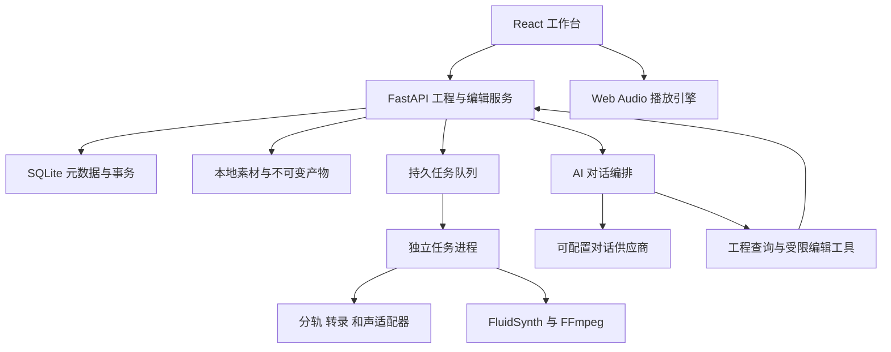

# 第一阶段技术方案

状态：2026-10-18 确定的开发基线；依赖与模型具体版本在 P0 实测后锁定。决策来源和兼容性门槛见[选型依据](08-references-and-decisions.md)。

## 系统结构

第一阶段使用本地单用户架构。浏览器、API、任务进程共同构成应用；发布形态先采用本地启动器打开浏览器，桌面外壳后续按需要增加。

## 技术选择

| 部分 | 选择 | 目的与约束 |
| --- | --- | --- |
| 前端 | React + TypeScript + Vite + pnpm | 实现定制工作台，严格类型约束与可重复构建 |
| 时间线 | Canvas 绘制波形/事件，DOM 提供交互控件与无障碍说明 | 避免大量音符 DOM 节点；视口裁剪和多级波形缓存 |
| UI 状态 | Zustand 保存播放/选区；TanStack Query 管理服务端状态 | 播放位置不触发整页刷新，工程版本以服务端为准 |
| 播放 | Web Audio API，统一 AudioContext | 所有音轨共享时钟，支持定位、循环、独奏与版本切换 |
| 后端 | Python 3.11 + FastAPI + Pydantic 2 + uv | 与音频生态衔接，接口和编辑参数显式校验 |
| 元数据 | SQLite WAL + SQLAlchemy 2 + Alembic | 单机事务、迁移、工程和任务状态持久化 |
| 大文件 | 本地文件系统，SHA-256 内容摘要 | 原始音频、分轨、渲染与模型文件不塞进数据库 |
| 任务 | SQLite 任务表 + 单个独立 worker，模型由受控子进程执行 | 可重启、取消、重试；第一阶段限制 GPU 并发为 1 |
| 实时反馈 | HTTP 命令 + SSE 任务/对话事件流 | 持久事件序号支持断线补发，无需第一阶段引入消息中间件 |
| 音频处理 | FFmpeg/ffprobe | 解码、重采样、混音、编码和元数据提取 |
| 分轨 | Demucs `htdemucs`，通过 SeparationAdapter | 基线分离 vocals/drums/bass/other；质量与速度在 P0 测定 |
| 多乐器转录 | MuScriptor medium 起步，通过 TranscriptionAdapter | 整曲 MIDI 初稿；small/large 仅在测量后调整 |
| 和声及结构 | SheetSage2，通过 AnalysisAdapter | 旋律、和弦、拍点、调性和结构候选；与转录事件交叉检查 |
| MIDI 与音乐逻辑 | mido + music21 | MIDI 读写、符号分析与候选验证；不把规则推断当成原曲事实 |
| 重建渲染 | FluidSynth 离线渲染 + 固定 GM SoundFont | 稳定、可重复的每声部与混合 WAV；音色映射可追溯 |
| AI | 供应商适配器 + 服务端工具执行循环 | 供应商可更换；具体服务在 P0 根据现有凭据配置 |
| 检查 | pytest、Vitest、Playwright | 数据、音频同步、编辑事务、完整浏览器流程 |

技术框架和模块边界已选定；模型运行结果、具体版本和对话服务尚待验证。P0 通过后提交锁文件和模型清单。所选模型失败时，先记录问题与替代对比，再更新决策，不能用空输出替代能力。

## 运行环境与隔离

本机已检测到 Windows、RTX 5080（16303 MiB 显存）、约 31.1 GiB 可见内存。先采用本机 GPU 推理；不能仅凭硬件规格承诺模型峰值内存或处理时长。

API 使用独立 Python 环境。MuScriptor、Demucs、SheetSage2 允许各自使用单独 uv 环境，避免 PyTorch、音频解码库和 Transformers 的版本冲突。API 与适配器子进程通过 JSON 请求清单、状态事件和文件产物交换数据，不共享 Python 对象。

GPU 任务依次加载模型并释放显存；OOM 时记录峰值、失败配置和当前阶段，可降低批量或切块后重试。CPU 模式必须显示真实耗时，不以静默退回 CPU 掩盖 GPU 不可用。

项目本地缓存使用 `models/`、`runtime/`，避免权重和临时文件散落到源码目录。下载前检查容量、访问条件及用户配置。服务绑定 `127.0.0.1`，浏览器写请求限制来源并使用本地会话令牌；API 密钥只保存在服务端。

## 整曲处理流水线

1. **导入**：复制素材到不可变存储，计算摘要，ffprobe 检查格式、声道、采样率和完整时长。
2. **规范化**：生成分析/播放派生文件和多级波形。保留原始文件，不做覆盖式响度归一化；各模型单独转换所需采样率。
3. **分轨**：生成全时长四分轨，保存与原录音的偏移和对齐检查。
4. **转录**：默认针对原混音执行 MuScriptor，保存原始输出与归一化事件。分轨再转录作为局部纠错路径，不能默认认为分离一定提高准确率。
5. **结构分析**：执行 SheetSage2，生成拍点、和弦、调性和段落候选。建立采用的节拍映射，同时保留冲突候选。
6. **归一化与对齐**：转换为统一工程数据，检查覆盖、边界重复、漏块、负时间、越界、轨道映射和不合理事件。
7. **初版重建**：生成各符号声部音频、混合音频及试听所需元数据。原曲、stems 与重建共享原曲零点。
8. **发布分析版本**：原子发布完整 manifest，记录问题清单；必需产物齐全且有效才将工程设为 `ready`。

最初选定一个完整录音用于开发，再增加不同曲风的验证样本。整曲任务的分块、重叠和合并由各适配器报告，不能用短片段输出替代完整时长。

## 任务恢复与缓存

每个任务有工程、阶段、输入摘要、模型/代码版本、参数摘要、状态、尝试次数、心跳、日志和产物列表。缓存键包含输入内容、模型权重版本、预处理配置与适配器版本；重新分析生成新的分析运行记录。

worker 通过租约领取任务，崩溃或重启后将过期任务标为 interrupted 并安排恢复。中间文件写入临时目录，校验后原子发布；未发布文件不参与后续计算。取消请求要终止本任务子进程树，关闭文件句柄并释放 GPU。

重试从最近有效阶段继续；模型没有内部断点能力时重做该阶段。GPU 串行不妨碍前端播放或读取已完成工程。并发数据库写入使用短事务和 busy timeout。

## 播放与渲染

统一 Transport 保存播放位置、循环范围、播放速率和当前试听版本。声音以 AudioContext 时间为准，动画帧只绘制指针。多音轨按共同计划时间调度，不使用多个独立 HTML audio 播放器同步。

采用有界分块解码缓存与前瞻调度，避免一次把整曲所有分轨和版本解码进内存。分块保留准确样本偏移，循环和 seek 重建调度，清除旧节点；播放缓冲不足时显式暂停/提示，不悄悄让声部漂移。保留 AudioWorklet 流式混音扩展入口，P0 通过压力测试决定是否提前使用。

修改后渲染绑定确定的 revision 和事件摘要。局部渲染须包含前置延音、控制器状态及混响尾音；第一版可采用受影响声部全曲重渲染保证连续性，再按实测优化缓存。禁止硬切选区导致截音后还宣称局部改编效果正确。

FluidSynth 的版本、SoundFont 摘要、program 映射、采样率、增益和效果参数进入 render manifest。音量比较提供响度匹配，导出保留原设置。

混合试听第一条路径为替换贝斯：`vocals + drums + other + 新贝斯渲染`。工程须标记哪些符号声部对应待替换贝斯；禁止同时叠加旧 bass stem。其他分轨中的贝斯残留只能作为分离质量问题报告，不能声称完全消除。

## AI 编排

对话服务通过供应商适配器提交消息、能力声明和工具定义。服务端执行实际工具，维护最大调用轮数、超时、取消与费用记录，向前端流式返回可见文本、引用和操作结果。

请求的上下文包含整曲摘要、当前 revision、选区和轨道；细节按需查询。长音符表通过工具分页，音频片段只在服务支持音频且用户配置允许上传时发送。文本对话服务也能基于结构化事件讨论与改编，但不能伪装为听过原录音。

AI 编辑必须进入统一领域服务，与手工编辑遵守相同的版本、范围和类型检查。实现时不暴露任意 Shell、SQL、文件路径写入或通用代码执行工具。接口细节见[数据与 AI 操作约定](04-data-and-ai-contracts.md)。

## 有意延后的实现

第一阶段使用本地文件和 SQLite，不需要账户系统、云对象存储、多用户协作或分布式调度。乐谱排版和 MusicXML/PDF 导出属于后续增强，第一阶段通过钢琴卷帘与 MIDI/WAV 完成研究、编辑和试听。

跨工程检索先保留实体与引用结构，后续再加入全文索引或向量检索。原创项目复用相同事件与渲染模型，模型微调不构成前置依赖。
