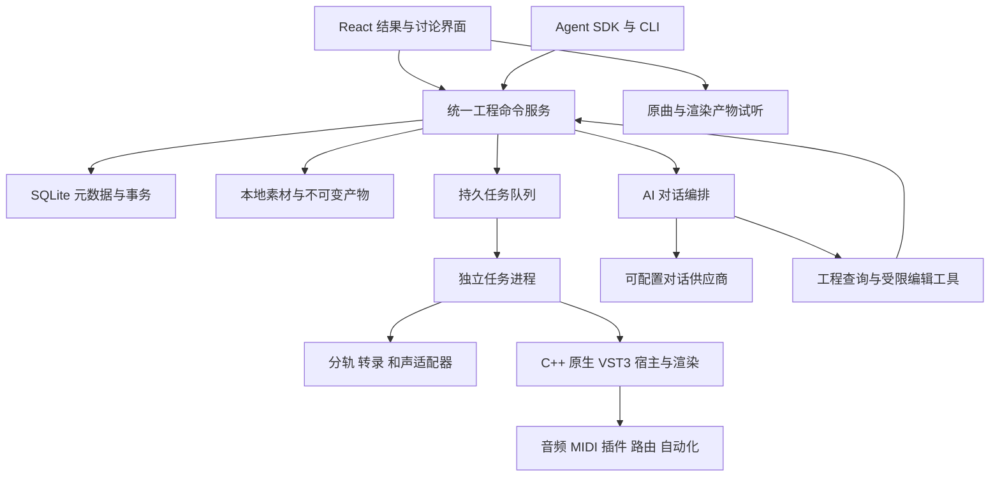

# 第一阶段技术方案

状态：2026-10-18，P0a/P0b 与 P1 已完成。JUCE 9.0.4 headless/MSVC、三模型与 Codex 探测已锁定；工程持久化和统一接口见 [P1 实现](14-project-service.md)。下图是第一阶段完整目标，模型流水线、制作与内置对话分别在 P2/P3/P4 接入。

## 系统结构

第一阶段使用本地单用户架构。AI 通过 API/SDK/CLI 操作全部工程能力；原生宿主负责声音处理，Python 负责工程与模型编排，浏览器负责展示、讨论和试听。发布形态可由本地启动器管理原生进程并打开浏览器，完整桌面外壳不影响核心制作接口。

## 技术选择

| 部分 | 选择 | 目的与约束 |
| --- | --- | --- |
| 前端 | React + TypeScript + Vite + pnpm | 呈现作品、讨论、状态、差异与试听；不要求 AI 操作界面 |
| 时间线 | Canvas 绘制波形/事件，DOM 提供交互控件与无障碍说明 | 避免大量音符 DOM 节点；视口裁剪和多级波形缓存 |
| UI 状态 | P1 最小主页用 React state + SSE/轮询；P3 再按时间线需求引入 Zustand/TanStack Query | 工程版本以服务端为准，P1 不建立另一份工程状态权威 |
| 音频引擎 | C++20 + CMake，JUCE 9.0.4 headless/MSVC 已验证 | Windows x64 VST3；P0a 支持受限处理图/阶跃自动化/补偿/渲染，复杂路由在 P3 |
| 试听 | Web Audio 播放原曲/已渲染产物 | 原生引擎拥有制作时间基准，前端只负责试听和位置显示；独奏/混合由引擎或受控 stems 提供 |
| 后端 | Python 3.11 + FastAPI + Pydantic 2 + uv | 与音频生态衔接，接口和编辑参数显式校验 |
| 元数据 | SQLite WAL + SQLAlchemy 2 + Alembic | 单机事务、迁移、工程和任务状态持久化 |
| 大文件 | 本地文件系统，SHA-256 内容摘要 | 原始音频、分轨、渲染与模型文件不塞进数据库 |
| 任务 | SQLite 任务表 + 单个独立 worker，模型由受控子进程执行 | 可重启、取消、重试；第一阶段限制 GPU 并发为 1 |
| 操作与反馈 | 类型化 HTTP API + SDK/CLI + SSE | 操作能力发现、实际状态回读、单条事务/顺序批处理和断线补发；前端/Agent 同源 |
| 音频处理 | FFmpeg/ffprobe | 解码、重采样、混音、编码和元数据提取 |
| 分轨 | Demucs `htdemucs`，通过 SeparationAdapter | 基线分离 vocals/drums/bass/other；质量与速度在 P0 测定 |
| 多乐器转录 | MuScriptor medium 起步，通过 TranscriptionAdapter | 整曲 MIDI 初稿；small/large 仅在测量后调整 |
| 和声及结构 | SheetSage2，通过 AnalysisAdapter | 旋律、和弦、拍点、调性和结构候选；与转录事件交叉检查 |
| MIDI 与音乐逻辑 | mido + music21 | MIDI 读写、符号分析与候选验证；不把规则推断当成原曲事实 |
| 重建渲染 | 原生引擎执行 VST3 音源与效果链 | 每轨/总线/整曲 WAV，插件状态与资源可回溯；FluidSynth 仅保留为可选参考适配器 |
| AI | Codex App Server + 应用领域工具，保留供应商适配器 | P0b 已用既有 ChatGPT 登录实测；正式服务/对话持久化后续接入，详见 docs/13-codex-integration.md |
| 检查 | CTest/原生宿主夹具、pytest、Vitest、Playwright | 真实插件处理、全操作 API、恢复、整曲能力；浏览器检查展示与试听 |

P1 使用 SQLAlchemy 2 Core 组织显式 SQLite 事务，Alembic 管理迁移。完整版本快照是权威，各实体表为同一事务生成的只读投影。23 个领域操作共用一个命令入口；独立 worker 的音频导入/插件扫描与检查已接通。其他模型/渲染/对话适配器仍在对应阶段接入，不能用空输出替代能力。

## 运行环境与隔离

本机已检测到 Windows、RTX 5080（16303 MiB 显存）、约 31.1 GiB 可见内存。先采用本机 GPU 推理；不能仅凭硬件规格承诺模型峰值内存或处理时长。

API 使用独立 Python 环境。MuScriptor、Demucs、SheetSage2 允许各自使用单独 uv 环境，避免 PyTorch、音频解码库和 Transformers 的版本冲突。API 与适配器子进程通过 JSON 请求清单、状态事件和文件产物交换数据，不共享 Python 对象。

VST3 扫描器与渲染宿主使用独立原生进程；工程服务通过版本化 JSON 请求与产物 manifest 交互，不在 Python 内直接加载插件。宿主按 SDK 提供消息循环；扫描崩溃/超时隔离插件，渲染崩溃只令当前任务失败。插件目录使用受控配置，凭据和用户采样库独立于源码。

GPU 任务依次加载模型并释放显存；OOM 时记录峰值、失败配置和当前阶段，可降低批量或切块后重试。CPU 模式必须显示真实耗时，不以静默退回 CPU 掩盖 GPU 不可用。

项目缓存使用受控模型运行目录，避免权重和临时文件散落到源码目录。P0b 因本机 E/C 盘空间不足，将独立环境和产物配置到 `D:\music-learning-runtime`；本地位置保存在忽略的 `runtime/model-runtime.json`，不修改系统环境。下载前检查容量、访问条件及用户配置。服务绑定 `127.0.0.1`，浏览器写请求限制来源并使用本地会话令牌；API 密钥只保存在服务端。

## 整曲处理流水线

1. **导入**：复制素材到不可变存储，计算摘要，ffprobe 检查格式、声道、采样率和完整时长。
2. **规范化**：生成分析/播放派生文件和多级波形。保留原始文件，不做覆盖式响度归一化；各模型单独转换所需采样率。
3. **分轨**：生成全时长四分轨，保存与原录音的偏移和对齐检查。
4. **转录**：默认针对原混音执行 MuScriptor，保存原始输出与归一化事件。分轨再转录作为局部纠错路径，不能默认认为分离一定提高准确率。
5. **结构分析**：执行 SheetSage2，生成拍点、和弦、调性和段落候选。建立采用的节拍映射，同时保留冲突候选。
6. **归一化与对齐**：转换为统一工程数据，检查覆盖、边界重复、漏块、负时间、越界、轨道映射和不合理事件。
7. **初版重建**：将符号声部映射到已通过测试的 VST3/预设，保存完整处理图并生成各声部/混合试听。无法映射的声部报告音色缺口；不能称临时替代音色为原曲音色还原。原曲、stems 与重建共享原曲零点。
8. **发布分析版本**：原子发布完整 manifest，记录问题清单；必需产物齐全且有效才将工程设为 `ready`。

最初选定一个完整录音用于开发，再增加不同曲风的验证样本。整曲任务的分块、重叠和合并由各适配器报告，不能用短片段输出替代完整时长。

## 任务恢复与缓存

每个任务有工程、阶段、输入摘要、模型/代码版本、参数摘要、状态、尝试次数、心跳、日志和产物列表。缓存键包含输入内容、模型权重版本、预处理配置与适配器版本；重新分析生成新的分析运行记录。

worker 通过租约领取任务，崩溃或重启后将过期任务标为 interrupted 并安排恢复。中间文件写入临时目录，校验后原子发布；未发布文件不参与后续计算。取消请求要终止本任务子进程树，关闭文件句柄并释放 GPU。

重试从最近有效阶段继续；模型没有内部断点能力时重做该阶段。GPU 串行不妨碍前端播放或读取已完成工程。并发数据库写入使用短事务和 busy timeout。

## 播放与渲染

原生引擎依据确定 revision 的样本时间、速度/拍号、MIDI、自动化和路由执行处理图。API 中的工程快照是权威数据，原生图是其派生运行状态，避免前端、Python 与引擎分别维护互相冲突的工程。

第一阶段优先离线渲染与自动化批处理，不要求超低延迟现场演奏、MIDI 键盘或录音。支持乐器→插入效果→轨道/总线→主输出，以及发送和基本侧链。验证图无非法环路、布局匹配、静音/旁通、插件延迟补偿和效果尾音。

修改后渲染绑定 revision、事件、插件完整状态、参数和依赖摘要。局部渲染须包含前置延音、控制器状态及尾音；影响发送、侧链或总线时重新计算依赖闭包，必要时全曲重渲染。禁止只重渲染被改轨而沿用失效的总线输出。

render manifest 记录宿主、插件 class ID/版本/二进制摘要、采样资源、状态、参数、自动化、总线布局、采样率、block size、延迟补偿和尾音策略。确定性插件可进行精确回归；随机插件保存冻结音频并用适当容差验证，不承诺所有插件位级重现。

浏览器播放原曲、渲染混合或同步 stems，保存位置、循环和 A/B 版本。采用有界解码缓存，避免所有版本一次载入内存。前端显示与实际试听版本一致，不能用过期渲染替代新版本。音量比较提供响度匹配，导出保留原设置。

混合试听第一条路径为替换贝斯：`vocals + drums + other + 新贝斯渲染`。工程须标记哪些符号声部对应待替换贝斯；禁止同时叠加旧 bass stem。其他分轨中的贝斯残留只能作为分离质量问题报告，不能声称完全消除。

## AI 编排

对话服务通过供应商适配器提交消息、能力声明和工具定义。服务端执行实际工具，维护最大调用轮数、超时、取消与费用记录，向前端流式返回可见文本、引用和操作结果。

请求的上下文包含整曲摘要、当前 revision、选区和轨道；细节按需查询。长音符表通过工具分页，音频片段只在服务支持音频且用户配置允许上传时发送。文本对话服务也能基于结构化事件讨论与改编，但不能伪装为听过原录音。

AI 编辑必须进入统一领域服务，覆盖轨道、片段、音乐事件、插件、路由、自动化、工程保存和渲染等所有已实现操作。SDK/CLI 和前端使用相同版本、范围与类型检查。工具返回实际状态、能力限制和产物，不能只回“已发送”。领域接口不暴露任意 SQL 或路径写入；接口细节见[数据约定](04-data-and-ai-contracts.md)和[AI 操作约定](09-agent-daw-contract.md)。

## 有意延后的实现

第一阶段使用本地文件和 SQLite，不需要账户系统、云对象存储、多用户协作或分布式调度。完整手工 DAW 编辑界面、键盘输入、录音、乐谱排版和 MusicXML/PDF 导出后置，首先验证 AI 无界面操作与 VST3 制作流程。

跨工程检索先保留实体与引用结构，后续再加入全文索引或向量检索。原创项目复用相同事件与渲染模型，模型微调不构成前置依赖。
