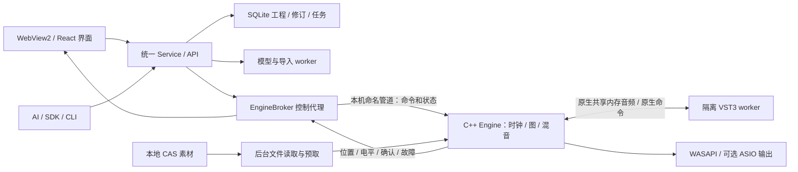

# 本地 DAW 架构决策

状态：2026-10-22，N1–N7已经验收并默认部署，固定源码d4852c6、原生bundle f0563ad2；两首整曲及30分钟循环通过。开发顺序见[迁移计划](../plans/native-daw-migration.md)，当前证据与性能差距见[最终核对](../benchmarks/native-engine-completion.md)，路径见[仓库目录约定](../development/repository-layout.md)。本文覆盖早期架构文档中“浏览器负责工程音频播放”的设计；保留现有工程、版本、素材、AI 与模型能力。

## 当前问题及范围

改造前桌面窗口是 WinForms/WebView2（`native/desktop/Main.cs`），工程控制由 Python Service/API/SDK/CLI 共用。离线制作是 `native/audio-host`，常驻音轨是 `native/live-track`；后者接受 JSON `chunk` 请求，经 Python 返回 PCM，再由浏览器混音并输出。已渲染声部由浏览器完整读取和decodeAudioData。这个历史路径现已由原生设备引擎替换，旧固定制作宿主仍为既有离线任务保留。

本轮解决的两个问题是整曲多轨解码造成较长冷启动和高内存，以及实时MIDI依赖Python/HTTP/浏览器供声及前端时钟。只换素材目录或请求大小不能消除这两个边界。

本次决定新增本地音频引擎，负责设备、播放时钟、音频读取、MIDI 调度、插件、混音和输出。前端继续负责视觉与交互，Python 继续负责持久工程、业务规则、模型任务和 AI。AI 无需操作 GUI，也不引入 MIDI 键盘需求。用户原曲三轨／纯音乐单轨、重建真实人声＋伴奏 MIDI、SheetSage 原曲参考及当前 MIDI 对照均保留。

## 组件和权威状态

| 数据 | 唯一权威 | 持久化时机 |
| --- | --- | --- |
| 音符、片段、插件状态、路由、原曲参考 | 既有 SQLite 不可变修订及 CAS | 既有编辑事务；保留原版本与幂等 |
| 声卡正在播放的样本位置、回调序号 | C++ Engine | 低频保存歌曲位置；不每块写数据库 |
| 监听推子、静音、独奏、声像 | 当前 Engine 会话 | 编曲保持临时；显式保存版本才记录现行要求中的值 |
| 独立混音配置 | 既有 mixing.version | 手动保存；导出冻结指定配置 |
| 当前装载的声音版本 | Engine 的 applied_revision / generation | 服务保存执行结果；不能用“事务已提交”冒充声音已就绪 |
| 波形、分析摘要、目录页 | 内容摘要绑定的派生数据 | 按需读取；不阻塞设备与播放 |

SQLite 是工程权威，不再新增一份需要双向同步的 project.json。EngineSession manifest 是由某一修订编译的、可重建的只读执行清单；包括 schema_version、project_id、revision_id、graph_hash、CAS SHA、状态 SHA、路由和样本时间，不能由 UI 任意修改。以后如需便携工程，显式导出 manifest＋引用素材包，重新导入时校验；不靠随意搬动正式数据库实现。

## 引擎、线程与进程

新增 `ml_engine.exe`，输出到 `runtime/build/engine-v1/`。使用现有固定 JUCE 源版本新增独立构建目标，加入 audio_devices 等所需模块；不覆盖现有 `ml_audio_host.exe`、`ml_track_host.exe`、固定静态库或验证批次宿主。第一设备后端为 WASAPI shared，不安装或更改系统驱动；ASIO 在已有设备与 SDK/许可条件明确后单独验收。44.1/48kHz、设备缓冲、断开及重选由引擎管理。

- **设备音频线程**：只消耗已准备音频、执行有界混音、应用无锁参数与推进样本计数。不读磁盘／数据库、发 HTTP／管道请求、计算 SHA、创建插件、分配大内存、等待锁或同步等待子进程。不在回调里复用原 live-track 的 JSON chunk 实现。
- **图编译／控制线程**：校验执行清单，编译图和 MIDI 事件，预分配缓冲；在块边界切换 immutable graph。资源回收发生在回调确认离开旧图后，不在回调中析构插件或大对象。
- **素材读取线程**：从本地 CAS 或校验后的工作格式文件读取，按当前位置预取；短音频可常驻，长音频有界缓存。解压、格式转换和重采样准备在后台完成。磁盘缓冲是引擎内部实现，声音不经过 HTTP/WebView2/Python。
- **插件 worker**：生产第三方 VST3 默认与设备引擎隔离；完整装载、状态还原与 processBlock 在原生 worker 中完成。原生命名管道承载小控制消息，共享内存环承载有序音频与样本标记；设备回调只读取已经完成的块，不同步等待 worker。内置确定性夹具可先在引擎内验证，但不能将其当作第三方插件隔离已经完成。
- **非实时服务线程**：Python 编排、AI、模型、目录和持久化各走既有能力，不参与声卡回调。

共享缓冲必须含 engine_session、generation、revision/graph_hash、block_sequence、source_sample 与有效帧数。容量有界；过期块丢弃、故障计数和队列溢出明确报告。固定且可测的提前量计入全图延迟补偿。慢／崩溃插件仅隔离受影响路径，不能卡死设备线程；超时不无限重试，不悄悄恢复旧声音。Keyscape 的历史离线采样等待／处理模式不可直接当作实时合格依据；Keyscape、Pianoteq 都需在新的引擎路径实测，既有455/797项离线或预设验证不自动等价于实时验证。

## 播放与编辑语义

打开工程时并行读取轻量清单、恢复设备和准备必要音轨；大型分析原始 JSON、历史快照、预设全集、整曲波形高分辨率层均按需加载。界面区分工程读取、设备就绪、插件装载、可播放和故障，显示实际进度，不使用无期限的省略号。

源样本时轴继续精确保留模型与手工编辑时序；设备采样率不同时，用有理数／累计相位映射源样本与设备帧，避免逐块取整漂移。VST 获取一致的 tempo、拍号、PPQ、循环及 transport 信息，拍速网格来自现有 timing map。单一设备时钟驱动音频、MIDI、循环、自动化、原曲／重建切换，前端只根据回读插值显示；UI 卡顿、后台或关闭聊天不改变声音时钟。

日常编辑流程：先通过既有事务提交修订，再由 EngineBroker 发送 revision diff。音符及兼容参数增量应用；资源变化在后台构建替代轨链并于明确样本边界切换。维护 desired_revision 与 applied_revision，超时／失败可重试具体操作，不能声称已换音色。监听参数无需音乐修订，应用时做短增益斜坡；独奏取消恢复手动静音。A/B 切换保留歌曲位置，不叠播两套音频。

精确匹配当前内容的已有音频缓存可以作为冻结轨使用；有编辑的 MIDI 优先由插件实时发声。缓存键含内容／插件完整状态／资源／路由／宿主指纹，过期缓存不能冒充当前声音。冻结／解冻是明确的轨道状态；不自动全曲渲染来掩盖不支持的实时处理。

原曲人声 MIDI 永不分配音源，不参与有声音轨静音计算；原曲实际播放分离的两条音频，纯音乐一条。重建真实人声与 MIDI 乐器共用引擎时钟。原曲参考和弦标签不自动冒充改编 MIDI 的新和声。

响度沿用持久校准、当前默认推子、共同混音和独奏增益，监听调整不触发重新归一化。设备引擎承担原有峰值保护并单独验证输出，不允许 WebAudio 和原生各加一次增益／限制器。音色库试听最终也进入引擎独立 preview bus，沿用试听时压低工程、结束后恢复；不会留下第二套设备时钟。

## 控制协议与生命周期

新增的 `engine.*` 操作须进入统一契约及 Service/API/SDK/CLI，名称在 N1 冻结；拟包括 devices、configure、open、status、transport、monitor、close。前端不新增绕过 Service 的任意文件／插件执行桥。EngineBroker 与引擎使用受当前 Windows 用户 ACL 保护的命名管道，随机会话令牌、协议版本和 PID/creation_time 身份握手；只解析编译器给出的白名单 CAS／已验证插件路径。JSON 只用于非实时控制，不携带音频。

命令带 request_id、session_id、sequence、expected_revision/generation，回执区分 accepted、applied、failed、superseded；监听合并发送且旧序号不覆盖新值。重连先回读实际设备／图／样本位置，不默认重放播放命令。状态以固定低频合并推送，计量约20–30Hz；每个音频块不产生 SSE、SQLite 记录或 Python 往返。

Engine 进程由既有所有权监督模式启动，管理自己的插件 worker；没有工程也可保持设备就绪，不持有无关插件。关工程释放图、素材和本会话；关应用／停止服务关闭所属进程。删除工程沿用 cleanup_ready 屏障，先停引擎读取、确认资源句柄释放，再删除记录与专属文件；不能重新引入删除后写回。设备丢失、引擎崩溃、插件失败分别暴露可定位状态。

## 实时图与导出

实时图逐步覆盖音频／MIDI轨、插件链、主输出、总线／发送／侧链、自动化及延迟补偿；尚未覆盖的图必须报告能力限制，不自动走浏览器或偷偷生成整曲 WAV。完整切换验收前保持旧入口可回退，但一次播放只能有一个引擎拥有输出。

显式导出仍是独立离线任务，冻结 revision 与 mixing_version。实时与导出共用图语义与插件适配，设备线程不执行文件导出。建模导入可暂时保留一次初始渲染／校准证据，重开与播放不依赖重新导入或全曲渲染；后续优化另测，不与本次设备重构混在一起。

## 官方依据与适用范围

这些资料说明可借鉴的机制，不表示我们实现了 FL Studio 的私有架构。2026-10-21 已核对：

- [FL Studio 工程格式](https://www.image-line.com/fl-studio-learning/fl-studio-online-manual/html/fformats_project.htm)：工程数据与外部样本可以分离，另有打包格式。
- [FL Studio 播放与缓冲](https://www.image-line.com/fl-studio-learning/fl-studio-online-manual/html/app_opt.htm)：实时生成短缓冲送音频设备，实时计算和导出文件是两种执行方式。
- [JUCE AudioDeviceManager](https://docs.juce.com/master/classjuce_1_1AudioDeviceManager.html)：设备管理与持续音频回调。
- [JUCE AudioIODeviceCallback](https://docs.juce.com/master/classjuce_1_1AudioIODeviceCallback.html)：设备高优先级线程回调；本项目采用更严格的无阻塞约束。
- [JUCE AudioTransportSource](https://docs.juce.com/master/classjuce_1_1AudioTransportSource.html)：后台预读能力的参考，不等于多轨同步／隔离插件图已自动实现。

实际开发以本仓库固定 JUCE 9.0.4 源码及许可为准，不因 master 文档而升级共享依赖。ASIO 及商业分发许可在引入／发布对应能力前单独核对，不在规划阶段改系统配置。
